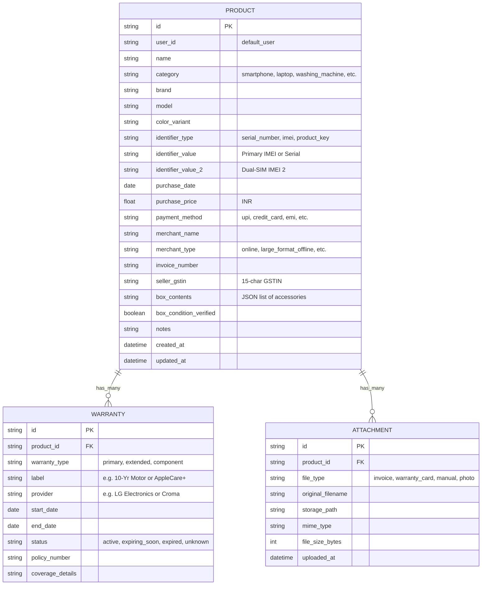
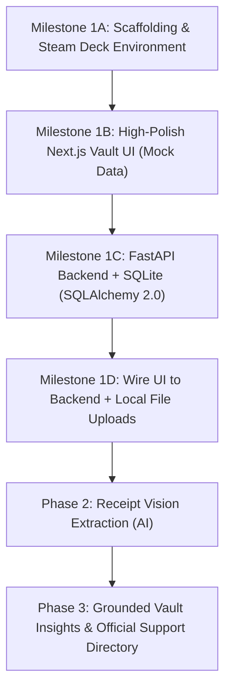

# Warrantify — Strategic Blueprint & Architecture Enhancements

## 1. Executive Summary & Vision Alignment
**Warrantify** is positioned as an intelligent **smart ownership hub** tailored to everyday consumers in India. It consolidates product invoices, serial/IMEI numbers, warranty coverage, and verified customer care details into a unified, visually polished interface.

**Core Philosophy:**
- **Tracker First, AI Second:** The product provides immediate, deterministic utility without relying on probabilistic AI models.
- **No Claims Submission Trap:** Avoids building brittle automated claim filing bots for the fragmented Indian service ecosystem. Instead, it equips users with exact data (invoice number, GSTIN, serial number, active coverage proof) to file claims effortlessly themselves.
- **Privacy & Local-First:** Invoices contain sensitive personal and financial data. Local-first architecture ensures security before cloud migration.

---

## 2. Better Suggestions & Additions Beyond the Scoping Doc

While the initial scoping document is solid, the following enhancements address practical realities of the Indian retail and warranty market:

### A. Tri-Warranty System (Named Warranties, No Generic Tiers)
* **The Reality:** Products in India have up to three distinct types of warranties:
  1. **Manufacturer's Warranty:** Standard 1–2 year comprehensive brand coverage direct from Apple, Samsung, LG, Sony, etc.
  2. **Extended Warranty:** Third-party or retailer protection plans (e.g. Croma ZipCare, Maple Care, AppleCare+, Servify, Reliance resQ, Samsung Care+, Amazon Protect).
  3. **Additional Warranty:** Specific component & parts coverage (e.g. 10-year inverter motor/compressor on appliances, 90-day parts warranty on replaced batteries or display panels).
* **Architecture:** Dedicated `Warranty` entity linked 1-to-many to `Product`, supporting any combination of Manufacturer's, Extended, and Additional warranties with distinct providers, dates, and policy numbers.

### B. Service-Center-Ready Checklist (India-First)
Indian authorized service centers (Samsung, Apple, LG, Voltas, etc.) demand exact records before initiating warranty repairs. Warrantify captures:
* **Identifiers:** Serial Number, Dual-SIM IMEI 1 & IMEI 2, or Software Product Keys, with one-click copy.
* **Invoice & Tax Data:** Invoice Number, Seller 15-character GSTIN, Merchant Name & Type (Online, Large-Format Offline, Local Retailer, Brand Direct).
* **Payment Details:** Mode of payment (UPI, Credit/Debit Card, Net Banking, EMI, Cash).
* **Box Contents & Condition:** Checklist of items that came in the box (cables, adapters, wall mounts, rat covers, manuals) and verification if the original box is preserved.

### C. Client-Side Image Optimization (PWA Optimization)
* **The Problem:** Modern smartphone cameras upload 8–15 MB raw images.
* **Recommendation:** Integrate client-side downscaling and compression (targeting 1500–2000px, WebP/JPEG ~400KB) before uploading.

### D. Single-Step Multimodal Extraction (Phase 2 Preview)
* Modern multimodal vision models (Gemini 1.5/2.0 Flash) allow passing invoice photos directly for structured extraction in one step, bypassing fragile local C-based OCR binaries.

---

## 3. Data Model (Implemented in SQLAlchemy 2.0 & Pydantic v2)


        string original_filename
        string storage_path
        string mime_type
        int file_size_bytes
        datetime uploaded_at
    }
```

---

## 4. Phased Step-by-Step Implementation Roadmap



### Milestone 1A: Scaffolding & Local Developer Experience
1. Verify SteamOS environment (`node`, `npm`, `python3`, `git`).
2. Setup monorepo:
   - `frontend/`: Next.js 14+ (App Router), TypeScript, Tailwind CSS, Lucide icons, `shadcn/ui`.
   - `backend/`: FastAPI, SQLAlchemy 2.0, Pydantic v2, SQLite (`warrantify.db`), Alembic.
   - Root automation: Single command runner to launch both frontend and backend seamlessly.
   - Next.js API rewrite proxy so `http://localhost:3000/api/*` proxies to FastAPI `http://127.0.0.1:8000/api/*` (eliminates CORS friction).

### Milestone 1B: High-Polish Interactive Frontend (Mock Data)
- **Vault Dashboard:**
  - Status summary bar: Active, Expiring Soon (<30 days), Expired.
  - Category filters with dedicated iconography (Smartphones, Computing, Home Appliances, Entertainment).
  - Search bar (by brand, product name, invoice number).
  - Realistic Indian product mock dataset (iPhone 15 from Amazon India, LG Smart Inverter Washing Machine from Croma, Sony Bravia 55", Samsung Galaxy S24).
- **Product Card & Detail Drawer:**
  - Expiry progress gauge.
  - Dual warranty display (Machine warranty + Compressor/Motor warranty).
  - Quick-copy buttons for Serial/IMEI and Invoice Number.
- **Add/Edit Product Modal:** Clean, structured form with validation.

### Milestone 1C: Backend Core API & Persistence
- Pydantic v2 schemas and SQLAlchemy models matching the expanded schema.
- SQLite database initialization (`backend/warrantify.db`).
- CRUD endpoints:
  - `GET /api/v1/products` (with filters & search)
  - `POST /api/v1/products`
  - `GET /api/v1/products/{id}`
  - `PUT /api/v1/products/{id}`
  - `DELETE /api/v1/products/{id}`
  - `POST /api/v1/products/{id}/attachments` (Multipart file upload to `backend/uploads/`)
  - `GET /api/v1/health`

### Milestone 1D: Integration & Local Verification
- Connect frontend hooks to live FastAPI endpoints.
- Test document upload (PDFs and images) with local file serving.
- Verify full flow running locally on SteamOS Desktop.

---

## 5. Decision Points for Your Confirmation

1. **Dual Warranty Inclusion:** Confirmed supporting secondary/component warranties (e.g. 10-year motor/compressor) in the initial MVP schema.
2. **Indian Identifiers:** Confirmed inclusion of `invoice_number`, `merchant_type` (online/offline), and `identifier_type` (serial vs IMEI).
3. **Execution Sequence:** Confirmed starting with **Milestone 1A (Scaffolding)** followed by **Milestone 1B (Mock UI Dashboard)** so you can test and approve the look and feel before finalizing the database schemas.

